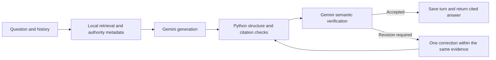

# Apex Global Policy Assistant

A Python retrieval-augmented generation (RAG) prototype for the ADC GenAI Engineer case: retrieve policy text, then give it to a model to answer a question. Upload policy PDFs, ask questions, and inspect cited PDF pages. The browser interface supports separate workspaces and saved conversations. A workspace is the document set and history linked by one `conversation_id`.

The prototype implements ingestion, retrieval, grounded answer generation, verification and persistence. It remains a local demonstration: live evaluations found reasoning and evidence-selection errors. See [evaluation evidence and limitations](docs/EVALUATION.md).

## Technology stack

| Concern | Technology |
| --- | --- |
| API and validation | FastAPI, Pydantic |
| Relational storage | SQLAlchemy with SQLite |
| PDF extraction | pypdf |
| Embeddings and vectors | Local MiniLM through CPU ONNX Runtime; persistent Chroma |
| Generation | Gemini `gemini-3.8-flash`, LOW reasoning |
| Verification | Separate Gemini `gemini-3.8-flash` call, LOW reasoning |
| Frontend | HTML, CSS and JavaScript served by FastAPI |
| Deterministic tests | pytest and HTTPX |

## Architecture

Upload parses text, creates page-local chunks, computes embeddings and stores vectors plus document metadata. Chat loads the last five messages and retrieves evidence scoped to that workspace.



Generation returns a status and cited answer. Verification compares the candidate with the question and evidence; Python derives its verdict from the issue list and checks status agreement. Exhausted checks return a controlled error without saving a partial turn. Policy answers normally use two model calls, with at most four logical calls including one correction or malformed-audit recheck. Each logical request can separately retry transient provider unavailability. Relevance-feedback acknowledgments and replies to empty retrieval use no model calls.

### Where to read the implementation

Source-file headers describe individual responsibilities. Start with these paths to follow a request:

| Files | Role |
| --- | --- |
| [main.py](app/main.py), [config.py](app/config.py) | Wire services at startup and load validated settings |
| [api/](app/api/) and [schemas.py](app/schemas.py) | Accept HTTP input, map errors and define response shapes |
| [models.py](app/models.py), [database.py](app/database.py) | Store workspaces, PDFs, authority metadata and messages |
| [ingestion.py](app/services/ingestion.py), [pdf_parser.py](app/services/pdf_parser.py), [chunker.py](app/services/chunker.py) | Extract page text, split embedding inputs and coordinate indexing/cleanup |
| [embeddings.py](app/providers/embeddings.py), [vector_store.py](app/providers/vector_store.py), [retrieval.py](app/services/retrieval.py) | Embed text, search workspace chunks and add bounded page context |
| [conversation_context.py](app/services/conversation_context.py), [policy_metadata.py](app/services/policy_metadata.py) | Build follow-up retrieval hints and document identity/lifecycle signals |
| [chat.py](app/services/chat.py), [prompt_builder.py](app/services/prompt_builder.py), [llm.py](app/providers/llm.py) | Build generation input, call Gemini and orchestrate verification/persistence |
| [answer_validation.py](app/services/answer_validation.py), [claim_verification.py](app/services/claim_verification.py) | Map citations and enforce the semantic audit gate |
| [conversations.py](app/services/conversations.py), [web/](app/web/) | Restore/delete saved workspaces and render the employee interface |
| [system.txt](app/prompts/system.txt), [verification.txt](app/prompts/verification.txt) | Model instructions for drafting and auditing; read verbatim at runtime |
| [scripts/](scripts/), [tests/](tests/) | Evaluation runners and controlled application checks |
| [pyproject.toml](pyproject.toml), [.env.example](.env.example), [setup_and_run.sh](setup_and_run.sh), [run_app.sh](run_app.sh) | Packaging/dependencies, example settings and local launch |

Evaluation data: [retrieval cases](evaluation/retrieval_cases.json) label expected PDF/pages; [conversation retrieval cases](evaluation/conversation_retrieval_cases.json) add follow-up turns; [policy answer cases](evaluation/policy_answer_cases.json), [natural answer cases](evaluation/natural_answer_cases.json) and [live edge cases](evaluation/live_edge_cases.json) define answer rubrics and pattern checks; [verifier calibration cases](evaluation/verifier_calibration_cases.json) provide synthetic fixed drafts; [saved draft verifier cases](evaluation/saved_draft_verifier_cases.json) provide recorded candidates; [retired case IDs](evaluation/retired_case_ids.json) exclude withdrawn scenarios. [Multi-turn answer cases](evaluation/conversation_answer_cases.json) and [question-scope verifier cases](evaluation/question_scope_verifier_cases.json) cover the latest quality regressions.

Prompt files and JSON fixtures have no added comment headers: prompt text affects model behavior, and JSON does not support comments. [.python-version](.python-version) selects the local Python version and likewise retains its required plain-value format.

## Installation and setup

Use Python **3.11–3.13**. Linux with Python 3.13 is the verified environment. First installation and the first embedding-model download require internet access.

From a new checkout:

```bash
python3.13 -m venv .venv
source .venv/bin/activate
python -m pip install -e '.[dev]'
cp .env.example .env
```

Set `ADC_GEMINI_API_KEY` in the local `.env`. Never commit it. If you already have a `.env`, keep it instead of copying over it. On Windows, create the environment with `py -3.13 -m venv .venv` and activate `.venv\Scripts\Activate.ps1`; use the same `python -m pip` commands afterward. Windows setup has not been independently verified.

Alternatively, `./setup_and_run.sh` performs runtime installation and launches the app on a Bash-based system. It does not install test dependencies; use `python -m pip install -e '.[dev]'` for development.

### Environment variables

All settings use the `ADC_` prefix. See [.env.example](.env.example) and [app/config.py](app/config.py).

| Variable | Default or purpose |
| --- | --- |
| `ADC_GEMINI_API_KEY` | Your key; required for hosted chat calls |
| `ADC_DATABASE_URL` | `sqlite:///data/runtime/app.db` |
| `ADC_VECTOR_STORE_PATH` | `data/runtime/chroma` |
| `ADC_MODEL_CACHE_PATH` | `data/model-cache` |
| `ADC_CHAT_MODEL`, `ADC_VERIFICATION_MODEL` | `gemini-3.8-flash` |
| `ADC_RETRIEVAL_TOP_K` | `5`; broader questions use the existing expanded window |
| `ADC_CHAT_THINKING_LEVEL`, `ADC_VERIFICATION_THINKING_LEVEL` | `LOW` |
| `ADC_CHAT_TIMEOUT_SECONDS` | `60` per provider request |

## Run and use

```bash
./run_app.sh
```

The launcher starts the backend and frontend together. Open **http://127.0.0.1:8000/**; API documentation is at **http://127.0.0.1:8000/docs**. Stop with `Ctrl+C`. A direct alternative is:

```bash
python -m uvicorn app.main:app --reload
```

1. Upload one or more of the eight [sample policy PDFs](data/sampleset_policies/sampleset_policies).
2. Ask a question about the uploaded documents. The first upload downloads and caches the local embedding model.
3. Open a citation to inspect the original PDF at its cited page.
4. Start a new workspace for another document set, or select an earlier entry under **Saved chats**.

Each launch opens an empty workspace; saved chats remain server-backed. Upload, history and health checks work without a Gemini key; chat requests needing hosted models return `503` until configured. Local data persists under `data/runtime/` and is excluded from Git.

## API

| Method and path | Purpose |
| --- | --- |
| `POST /upload` | Multipart `conversation_id` and PDF `file`; confirms indexing |
| `POST /chat` | JSON `conversation_id` and `message`; returns answer and citations |
| `GET /conversations` | List saved chats |
| `GET /conversations/{conversation_id}` | Restore indexed sources and messages |
| `DELETE /conversations/{conversation_id}` | Permanently remove a workspace and its indexed data |
| `GET /documents/{document_id}/content?conversation_id=...` | Open an original PDF belonging to that workspace |
| `GET /health` | Returns `{"status":"ok"}` |

Chat responses contain `conversation_id`, `status`, `answer` and `citations`. Status is `answered` for usable partial/full support, `insufficient_context` for unsupported topics, or `conflicting_sources` for material unresolved contradictions/applicability ambiguity. Grounded answers cite PDF/page evidence; unsupported-topic abstentions have no citations.

## Tests and evaluation

Install development dependencies, then run controlled application tests without a Gemini key:

```bash
python -m pytest -q
```

All **150 local tests pass** for DEC-069. They cover controlled application behaviour, including question boundaries, citation checks, page enrichment and bounded failures; they do not measure live model accuracy. The obsolete four-attempt fallback test now checks the existing two-attempt `502` response and absence of saved messages.

For a focused upload/chat/history check:

```bash
python -m pytest tests/test_foundation.py tests/test_upload.py tests/test_chat.py tests/test_web.py -q
```

Local retrieval checks use the real cached embedding model and temporary storage:

```bash
python scripts/evaluate_retrieval.py
python scripts/evaluate_conversation_retrieval.py
```

Live evaluation is explicit opt-in and uses API tokens. With a configured key and an approved budget, select a case before considering a wider run:

```bash
python scripts/evaluate_policy_answers.py --live --case historical_travel --output evaluation/results/live.json
```

For actual multi-turn answer checks, including the reported meal-to-expense conversation:

```bash
python scripts/evaluate_conversations.py
python scripts/evaluate_conversations.py --live --repeat 3 --output evaluation/results/conversations.json
```

Without `--live`, this runner validates its fixtures without hosted calls. Live runs preserve their own generated conversation history in temporary storage; review every answer against the recorded rubric. The fixed verifier runner also accepts `--case-file evaluation/question_scope_verifier_cases.json` for balanced topic, citation and status regressions.

The runners also support fixed-candidate verification and resuming interrupted end-to-end runs. Fixtures are checked in; generated results are ignored. [EVALUATION.md](docs/EVALUATION.md) separates deterministic checks, historical live scores and subsequent targeted observations.

## Design decisions and trade-offs

### A. Employee-focused interface

**Why:** Reduce search effort and make answers easy to verify.

**What:** A browser chat interface supports PDF uploads, saved workspaces and clickable document/page references. Generation instructions ask for concise answers that lead with the requested decision or gap. Citation links open the retained original PDF; older uploads without stored bytes cannot be opened until re-uploaded in a new workspace.

**Trade-off:** Employees get easier access and source inspection, but the interface adds development and maintenance. Inspectable citations help review an answer; they do not prove its reasoning is correct.

**Implementation:** [index.html](app/web/index.html), [app.js](app/web/app.js), [styles.css](app/web/styles.css), [PDF endpoint](app/api/documents.py), [workspace service](app/services/conversations.py) and [generation instructions](app/prompts/system.txt).

### B. Answer generation–verification structure

**Why:** Valid citations do not guarantee correct reasoning.

**What:** Python validates the generated JSON/status and checks citation format, known source IDs and status/citation consistency. A separate LLM call is instructed to check relevance, completeness, evidence support and policy applicability, including conditions, numerical boundaries and unresolved contradictions. It receives the actual current question, prior user messages separately for references/scenario facts, the draft and every retrieved passage, including uncited passages, with the same authority metadata used for generation. Assistant history is excluded from the audit input. Both calls use `gemini-3.8-flash` with LOW reasoning by default, with separate drafting/audit instructions. This is a separate call, not an independent model family. The [focused comparison](docs/QUALITY_IMPROVEMENT_RESULTS.md) explains this choice and its limits.

The audit returns a comparison, an answer status and material issues. Python accepts an empty issue list only when the audit status matches the draft. It does not independently validate the audit's reasoning or check that its prose agrees with its issues. A rejected draft is regenerated from the original question/evidence and audit feedback, without adding the rejected answer as another assistant turn. A malformed audit rechecks the same draft. The two-attempt budget is unchanged; exhausted checks return an error and save neither message.

**Trade-off:** Additional checks can catch errors, but add API cost and latency. Both calls use the same model and provider, so they can share reasoning errors, approve a deficient answer or reject a sound one. Verification cannot inspect evidence omitted by retrieval.

**Implementation:** [chat orchestration](app/services/chat.py), [Gemini contracts/adapters](app/providers/llm.py), [citation validation](app/services/answer_validation.py), [audit input/gate](app/services/claim_verification.py) and [verification instructions](app/prompts/verification.txt).

### C. Policy interpretation flow

**Why:** Policies may be outdated, conflicting or incomplete.

**What:** Ingestion extracts title, document type, policy/reference ID, version, effective date and lifecycle signals where recognizable. For retrieved documents, Python identifies same-ID revisions only when dates can be ordered and the latest document explicitly replaces prior versions. It also suggests interim succession through lifecycle wording, dates and shared title/ID terms. Generation and verification instructions distinguish resolved revisions, compatible scopes, unsupported topics and material unresolved conflicts; uncertainty is expressed in the answer and its status.

Metadata has no structured geography, employee group, policy owner or approval record. Scope and exceptions must be interpreted from retrieved text. These are heuristic signals and model instructions, not a complete policy registry or guaranteed conflict detector; recency alone does not establish authority.

**Trade-off:** Clearer policy handling requires more metadata and interpretation logic. Missing labels, broad successor matches or ambiguous wording can still lead to an incorrect applicability decision. A maintained enterprise policy registry and owner review remain proposed improvements.

**Implementation:** [metadata extraction/resolution](app/services/policy_metadata.py), [metadata loading](app/services/chat.py), [generation input](app/services/prompt_builder.py) and both [generation](app/prompts/system.txt) and [verification](app/prompts/verification.txt) instructions.

### Implementation notes

- **Explicit Python layers:** FastAPI routes, focused services and provider protocols keep the flow visible and allow test fakes. This avoids a large orchestration framework, but leaves coordination and error handling in project code.
- **Local storage and embeddings:** SQLite, persistent Chroma and CPU MiniLM need no hosted embedding service. Two stores require compensating cleanup; the small model and synchronous execution limit the local prototype.
- **Page-local chunks:** Defaults target 180 tokens, cap at 220 and aim for 30 tokens of whole-word overlap. Paragraphs/sentences are preferred, with word splitting as fallback. Page provenance helps citation inspection, but related rules can be separated. See [chunker.py](app/services/chunker.py).
- **Hybrid retrieval:** Cosine search is combined with keyword ranking and exact identifier/number boosts. Bounded enrichment prioritizes all selected pages before document headers and neighbours of the strongest two hits. It helps recover context at the cost of larger prompts, without proving full-document coverage. See [retrieval.py](app/services/retrieval.py).
- **History and persistence:** Use the latest five individual messages in chronological order. Language heuristics inherit user topics only for retrieval. Models receive the actual current question separately; completed user/assistant messages commit together. Restored messages retain citations but lose separate status badges.
- **Bounded recovery:** Two attempt cycles limit correction/audit recheck costs. Provider unavailability retries separately; a sound answer can still fail after the limited recovery budget.
- **Reproducibility:** Direct dependencies are pinned and UI/prompt assets are packaged. Transitive versions are not locked, and an independent clean-machine setup remains unverified.

See [architecture](docs/ARCHITECTURE.md), [decision history](docs/DECISIONS.md), [requirements](docs/REQUIREMENTS.md), and the [recorded questions and answers](docs/LIVE_QUESTIONS_AND_ANSWERS.md).

### Enterprise architecture, deployment and evaluation — proposed

The implemented prototype has local uploads/storage, workspace retrieval, the browser interface, answer checks and manually invoked evaluation runners. Repository connectors, queued ingestion, identity/document permissions, managed cloud deployment, authorization-aware caching, automated evaluation/release gates, monitoring, drift detection, retention and employee rollout are separate strategy work. No cloud stack has been selected or deployed. See [enterprise direction](docs/ARCHITECTURE.md#enterprise-direction--not-implemented) and [pending requirements](docs/REQUIREMENTS.md#part-2--enterprise-strategy).

## Known limitations

### Current implementation

Possible mitigations below are future work unless explicitly described as existing behavior.

| Cause | Practical impact | Possible mitigation |
| --- | --- | --- |
| **PDF extraction:** pypdf reads text without OCR or layout reconstruction; textless pages are skipped. Encrypted/textless files are rejected and uploads are capped at 10 MiB. | Scans cannot be read; mixed scanned/text PDFs can be partly indexed. Columns/tables can lose meaningful order. | Review extracted text against the original PDF; add OCR/layout handling and page-level quality checks if the corpus needs them. |
| **Chunk boundaries:** Chunks stay within pages and split oversized paragraphs/sentences. Overlap repeats whole words and is dropped if it would exceed the maximum. | Rules, headings and exceptions can separate; overlap is approximate. A single unsplittable unit above the maximum fails ingestion. | Existing page enrichment helps; evaluate structure-aware splitting and cross-page context on representative documents. |
| **Embedding inputs:** MiniLM maps text to similarity vectors rather than interpreting policy logic. Its adapter truncates at 256 tokens; default document chunks fit below that, but retrieval queries are not token-bounded. | Long resolved questions/search hints can lose trailing dense-search context. Similarity does not establish applicability or numerical correctness. | Existing keyword/identifier boosts help; test long queries and alternative models before changing query construction or embeddings. |
| **Missing retrieval context:** Enrichment prioritizes selected pages, but considers only the first six chunks per page within a 12-companion limit (24 for expanded questions); document starts can also be appended. There is no total prompt-token budget. | Unselected pages or chunks beyond these bounds remain invisible to both readers; larger contexts can strain API limits. | Selected-page priority now has a regression check. Evaluate evidence coverage on larger documents and consider an explicit token budget; verification cannot recover omitted text. |
| **Policy metadata:** Extraction recognizes selected labels/wording; successor matching uses shared words and dates. Only retrieved documents are compared, and scope is not structured. | Missing IDs/dates, broad matches or future-dated policies can mislead applicability. There is no deterministic check against today's date or full conflict inventory. | Maintain reviewed identity, effective/expiry and scope records with policy owners; keep ambiguous decisions explicit. |
| **Conversation context:** Retrieval uses approximate wording heuristics and the latest relevant user message within five records. Both readers interpret the current question separately from prior context. | References beyond that window can be lost; retrieval hints, feedback classification or model interpretation can still be wrong. | The relative-clause regression is covered locally and live; use complete questions and test varied references before expanding history. |
| **API execution:** Upload, retrieval and model calls run synchronously inside async routes. Timeouts apply per provider request; 503 retries can multiply elapsed time, and 429 limits return an error. Output-token caps can produce invalid JSON. | One slow request can block other work; the 60-second default is not a whole-chat deadline. Failed verification/provider calls return no saved turn. | Queued ingestion, nonblocking serving and end-to-end deadlines need a separate design and concurrency tests. |
| **Storage and restoration:** SQLite/Chroma do not share a transaction; cleanup is compensating. Messages omit answer status; legacy uploads can lack original bytes. | Failure can leave stores inconsistent, including partial deletion. Restored status badges disappear and older source links may be unavailable. | Existing failed-state/error handling helps diagnosis; add reconciliation, reviewed migrations and persisted status if required. |

### Model and verification risks

Both readers can misapply geography, versions, thresholds or missing conditions despite valid citations. The verifier can falsely approve or reject an answer; Python checks its JSON and issue/status gate, not the truth of the audit. The one-correction budget also cannot repair a wrongly accepted draft. Mitigate through source inspection, balanced verifier calibration and manual review of consequential decisions; verification does not eliminate hallucinations. [Recorded evaluations](docs/EVALUATION.md#known-reasoning-and-retrieval-gaps) document actual errors, including false approvals.

### Untested enterprise requirements and evidence limits

- **Access and data handling:** There is no authentication or user-level authorization; workspace IDs only scope records. Hosted generation sends questions, recent history and retrieved text/metadata to Gemini; verification sends the current question, recent user messages, draft and evidence. The local prototype does not enforce an enterprise data-egress or retention policy. Production use would need identity/document permissions, provider/data approval and lifecycle controls.
- **Scale and deployment:** Synchronous processing, workspace-wide keyword scans and local storage have not been load-tested for enterprise traffic. No scalability, availability or security assurance follows from the local demo. Validate a separate serving/deployment design against agreed targets.
- **Evaluation and portability:** Controlled tests establish application behavior under supplied fakes; selected live runs and pattern checks do not establish general accuracy. No automatic release gate is implemented. Transitive dependencies and other OS/Python setups are not fully locked or independently verified. Use representative repeated/manual evaluations, release criteria and clean-machine checks before making broader claims.
