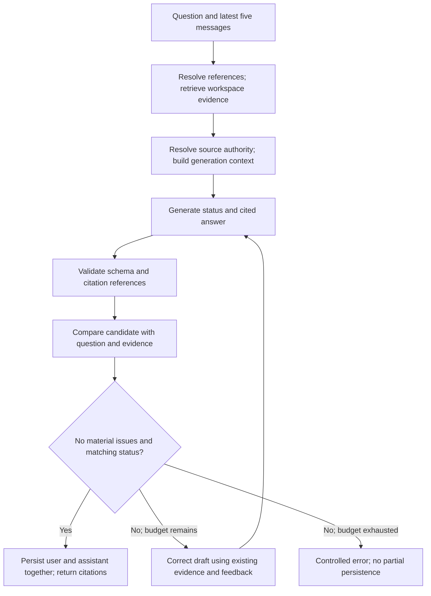

# Architecture

This describes the implemented local prototype. Enterprise components below are proposals. The current reviewer entry point is [README.md](../README.md); measured outcomes are in [EVALUATION.md](EVALUATION.md).

## Components

| Location | Responsibility |
| --- | --- |
| `app/api/` | HTTP validation, error mapping and response contracts |
| `app/services/` | Ingestion, retrieval, conversation context, authority and answer checks |
| `app/providers/` | Embedding, vector-store and Gemini interfaces/adapters |
| `app/models.py`, `app/database.py` | Relational records and sessions |
| `app/prompts/` | Generation and verification instructions |
| `app/web/` | Browser workspace, saved chats, uploads and PDF citations |
| `scripts/`, `evaluation/` | Reproducible evaluation runners and question fixtures |

Provider protocols allow replacement of a model/store and deterministic test fakes without changing the API. The current application uses FastAPI, SQLite, persistent Chroma, local MiniLM, Gemini Flash drafting and verification. No separate frontend server or JavaScript build is required.

## Upload

`POST /upload` accepts a caller-supplied conversation ID and PDF. It validates size/signature, creates or reuses the conversation, and rejects duplicate active content in that workspace. pypdf extracts readable text per page without OCR or layout reconstruction; textless pages are skipped. The chunker targets 180 model tokens, caps at 220 and aims for 30 tokens of whole-word overlap without crossing page boundaries. Overlap is approximate and is dropped if the next unit would exceed the maximum.

Local `all-MiniLM-L6-v2` produces 384-dimensional CPU embeddings. Chroma stores vectors, text and provenance; SQLite stores metadata, authority signals and the original PDF for citation viewing. Success requires vector-count confirmation and relational finalization. Failure retains a failed record and attempts vector cleanup. The stores do not share an atomic transaction.

## Chat

Retrieval combines conversation/model-filtered cosine search with local keyword ranking and weighted rank fusion. Semantic ranking remains primary. Bounded enrichment fetches selected pages, document starts and immediate neighbours of the two strongest page hits; overlapping chunks are consolidated per PDF page. Enrichment prioritizes all selected pages before headers and neighbours. It considers the first six chunks per requested page within a 12-companion budget (24 for expanded questions), then may append document starts. Pages beyond these bounds can remain partial; no full-document coverage is implied.

Authority metadata records title/type, policy or reference ID, version, effective date and lifecycle signals. Geography, employee group, owner and approval are not structured fields; models interpret scope from policy text. Same-ID supersession requires sortable dates and explicit replacement wording. Interim succession uses a shared title/ID-word heuristic with date ordering, so it can match too broadly. Resolution covers retrieved documents rather than the entire workspace, and does not check dates against today. A newer date alone does not establish replacement. Prompts tell models to treat documents, history and review feedback as untrusted data rather than instructions or independent policy authority.

Generation returns `{status, answer}` with internal source markers. Python validates structure, known source IDs, numeric-marker integrity and grounded/abstention citation constraints. It constructs public citations deduplicated by document/page. Citation existence is deterministic; semantic support is model-assessed.

The verifier receives the actual current question, prior user messages separately for reference/fact resolution, the candidate and the same bounded source text/authority metadata, including uncited passages. It gets no assistant history or additional retrieval. Follow-up heuristics affect retrieval hints only, never redefine the current task. Its model response has `{evidence_answer, answer_status, issues}`: a direct comparison, independent status and material defects. Python derives `verdict` from `issues` and checks status agreement; it does not verify the audit reasoning or agreement between audit prose and issues. Both calls use `gemini-3.8-flash` with LOW reasoning and separate instructions. The [quality comparison](QUALITY_IMPROVEMENT_RESULTS.md) records the tested configuration and remaining risks.

Normal policy responses use generation plus verification. Two attempt cycles allow one fresh redraft or a malformed-audit recheck against the same draft. Redrafting retains the original question/evidence and defect feedback, without appending the rejected answer as an assistant turn. At most four logical calls are made; transient provider unavailability can retry a request up to three physical attempts. Failed/unverified turns are not persisted. Successful turns persist atomically in SQLite.

Relevance-feedback acknowledgments and empty-retrieval replies bypass both model calls and are saved locally. Upload and chat service work runs synchronously inside async routes; provider timeouts are per request, not whole-chat deadlines. This path has not been load-tested for enterprise concurrency.

## Status and history

- `answered`: applicable policy facts answer at least part of the question, with citations and explicit remaining gaps.
- `insufficient_context`: no applicable rule supports the topic; explain the absence without citations.
- `conflicting_sources`: unresolved applicable contradictions or material ambiguity prevent a definite decision.

A fresh browser workspace does not erase server-side saved chats. Opening a saved entry restores its messages and sources; confirmed deletion removes relational records and document vectors. PDF access checks membership in the requested workspace. There is no authentication, so this is a single-user local boundary rather than a multi-user authorization model.

## Extension boundaries and trade-offs

Keep retrieval/model changes measurable through the existing provider/service boundaries. Add no policy-specific production answers. The same-model generation/verifier pair can share errors, bounded context cannot prove a complete policy review, and an independent verifier cannot inspect omitted evidence. See the preserved [decision log](DECISIONS.md) for accepted and superseded choices.

## Enterprise direction — not implemented

A production platform would separate queued ingestion workers from serving, integrate approved document repositories, and enforce identity/document permissions before retrieval. It needs versioned indexes, evaluation/release gates, privacy-aware telemetry, policy-owner remediation, retention, feedback and incident workflows. Cache keys must include authorization and data versions.

Cloud services, operational targets and rollout/training for 10,000 employees need explicit decisions and a stakeholder presentation. These are separate ADC strategy deliverables; no enterprise deployment or readiness is claimed here.
