# Apex Global — core prototype architecture

**Upload policies, ask a question, and receive an evidence-grounded answer with PDF citations.**

```mermaid
flowchart LR
    PDF["Input: policy PDFs"] --> UI
    UI -->|POST /upload| INGEST["PDF ingestion<br/>Extract → chunk → embed"]
    INGEST --> STORE[("Chroma: indexed policy chunks<br/>SQLite: PDFs, metadata, history")]

    QUESTION["Input: question<br/>+ conversation ID"] --> UI["Interface<br/>Web UI / REST API"]
    UI -->|POST /chat| RETRIEVE["Retrieve context<br/>Policy evidence + authority<br/>Last 5 messages"]
    STORE --> RETRIEVE
    RETRIEVE --> GENERATE["Answer generation<br/>Gemini Flash"]
    GENERATE --> CHECK["Python checks<br/>JSON, status, source IDs<br/>and citation integrity"]
    CHECK --> VERIFY["Semantic verification<br/>Gemini Flash<br/>Relevance, support, applicability"]
    VERIFY --> GATE{"Python decision<br/>No issues?<br/>Statuses agree?"}
    GATE -->|Accepted| OUTPUT["Output to interface<br/>Answer + status<br/>+ PDF/page citations"]
    CHECK -.->|Invalid draft| GENERATE
    GATE -.->|Correction feedback| GENERATE

    SYSTEM["system.txt<br/>How to answer using evidence"] -.-> GENERATE
    PROMPT["verification.txt<br/>How to assess the draft"] -.-> VERIFY
    RETRIEVE -.->|Same policy evidence + authority| VERIFY

    classDef model fill:#ede9fe,stroke:#7c3aed,color:#1f2937;
    classDef python fill:#dbeafe,stroke:#2563eb,color:#1f2937;
    classDef output fill:#dcfce7,stroke:#16a34a,color:#1f2937;
    class GENERATE,VERIFY model;
    class CHECK,GATE python;
    class OUTPUT output;
```

- **Grounding:** Both model calls use the same retrieved policy evidence. Accepted turns are saved; citations open the original PDF page. Semantic verification can still make mistakes.
- **Bounded workflow:** Normally **2 model calls**; at most **1 answer correction** using existing evidence. Exhausted checks return a controlled error.
- **Response status:** `answered` for full or partial support; `insufficient_context` for unavailable information (no citations); `conflicting_sources` for unresolved material conflict or ambiguity.

Prompt files: [system.txt](../app/prompts/system.txt) · [verification.txt](../app/prompts/verification.txt).
