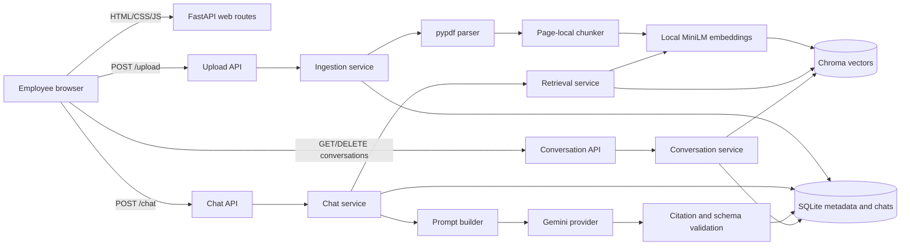
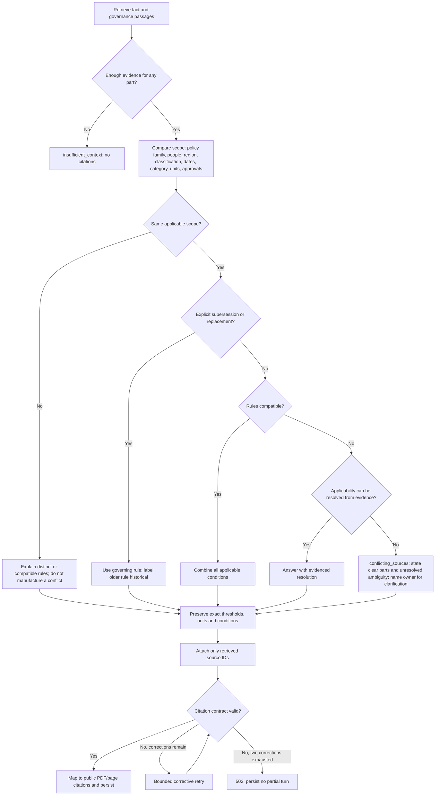
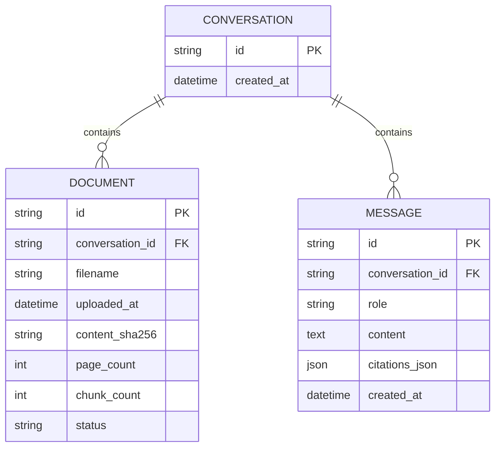

# Apex Global Policy Assistant — Implemented Solution Blueprint

## 1. Purpose and boundary

This document is the single implemented blueprint for the local interview prototype.
It explains the codebase, key decisions, motivations, request flows, data model,
quality controls and known limitations. `docs/DECISIONS.md` remains the chronological
decision record, including alternatives and superseded choices.

The prototype lets an employee create a browser-managed workspace, upload one or more
policy PDFs, ask conversational questions, and receive answers grounded in retrieved
PDF passages with filename and page citations. It is a local demonstrator, not the
final enterprise platform.

## 2. Key decisions and motivations

| Decision | Choice and motivation | Main trade-off |
| --- | --- | --- |
| API framework | FastAPI for typed contracts, generated Swagger and a small Python service | Synchronous service work can block under production load |
| Relational persistence | SQLAlchemy with SQLite for transparent local metadata and chats | No migrations, multi-node scale or shared transaction with vectors |
| Vector storage | Persistent Chroma with conversation/model metadata filters | Local prototype store, not enterprise authorization infrastructure |
| PDF extraction | `pypdf`, preserving one-based page provenance | No OCR for scanned PDFs |
| Chunking | Logical, token-aware, page-local chunks with bounded overlap | A fact split across pages is not merged during ingestion |
| Embeddings | Local 384-dimensional `all-MiniLM-L6-v2` through ONNX CPU | Small model is fast/private but has weaker semantic recall than larger models |
| Upload semantics | Synchronous indexing; return `201` only after vector-count verification | Simpler and honest, but large uploads increase request latency |
| Workspace scope | Every document and vector is filtered by `conversation_id` | Local IDs are not user authentication or authorization |
| Normal retrieval | Top-five semantic results, page diversity, bounded page companions and two document headers | Heuristic enrichment can include extra context |
| Broad retrieval | Top 20 plus bounded selected-page expansion for comparisons, exhaustive lists and authority ambiguity | Larger prompts and latency for those intents |
| History | Five latest stored messages, chronological; current question separate | Heuristic follow-up resolution can still miss unusual wording |
| Assistant text | Prior assistant messages provide conversational continuity but never policy evidence or retrieval facts | Corrections rely on freshly retrieved documents |
| Generation | Gemini Flash behind a provider protocol; deterministic fakes in tests | Hosted inference has availability, quota and data-transfer implications |
| Answer contract | Structured `status`, answer and internal source IDs | Model formatting can still fail and require recovery |
| Citations | Treat validated inline markers as canonical, normalize redundant `source_ids`, then create public `[1]` markers and filename/page objects | Mapping validation is not full claim-entailment verification |
| Invalid model output | Allow at most two narrow correction attempts, then fail without persistence | Rare malformed responses add latency/quota |
| Missing evidence | Abstain; answer supported portions while identifying unsupported portions | Nearest-neighbor retrieval alone cannot prove corpus absence |
| Policy conflicts | Compare scope first; distinguish superseded, compatible, ambiguous and truly conflicting rules | Prompt-enforced reasoning remains probabilistic |
| Web client | Semantic HTML/CSS/plain JavaScript served by FastAPI | No frontend framework or browser test harness |
| Saved chats | Server-backed listing/restoration/deletion; open a fresh chat on launch | Reload does not automatically resume the last chat |
| Testing | Deterministic suite plus real-embedding evaluations and separately reported live checks | Local passes do not equal guaranteed live-model correctness |

## 3. System structure



## 4. Repository map

```text
app/
├── main.py                 application factory and dependency wiring
├── config.py               environment-backed validated settings
├── database.py             SQLAlchemy engine/session lifecycle
├── models.py               Conversation, Document and Message tables
├── schemas.py              public request/response models
├── api/
│   ├── health.py           GET /health
│   ├── upload.py           POST /upload
│   ├── chat.py             POST /chat and provider error mapping
│   ├── conversations.py    list, restore and delete saved workspaces
│   └── web.py              employee-facing page and static assets
├── services/
│   ├── pdf_parser.py       page-aware text extraction
│   ├── chunker.py          logical token-aware chunks
│   ├── ingestion.py        upload/index orchestration and compensation
│   ├── retrieval.py        semantic search and bounded enrichment
│   ├── prompt_builder.py   System + History + Context + Question
│   ├── chat.py             conversation, generation, citations, persistence
│   └── conversations.py    saved-chat summaries and deletion
├── providers/
│   ├── embeddings.py       local MiniLM provider boundary
│   ├── vector_store.py     Chroma provider and provenance mapping
│   └── llm.py              Gemini provider and structured output
├── prompts/system.txt      grounding and policy-reasoning contract
└── web/                    index.html, styles.css and app.js

evaluation/                 versioned retrieval and answer scenarios
scripts/                    repeatable real-model/retrieval verification
tests/                      deterministic unit and API integration suite
docs/                       requirements, decisions, plans and results
data/runtime/               ignored local SQLite/Chroma runtime state
data/model-cache/           ignored local embedding-model cache
```

## 5. Upload flow

```mermaid
sequenceDiagram
    actor User
    participant API as POST /upload
    participant Ingest as IngestionService
    participant DB as SQLite
    participant PDF as PDF parser
    participant Chunk as Chunker
    participant Embed as MiniLM
    participant Vector as Chroma

    User->>API: conversation_id + PDF
    API->>API: validate fields and byte limit
    API->>Ingest: sanitized filename and bytes
    Ingest->>DB: check duplicate; create conversation/document(processing)
    Ingest->>PDF: extract non-empty pages
    PDF->>Chunk: page text with original page numbers
    Chunk->>Embed: bounded chunk texts
    Embed->>Vector: vectors + text + provenance
    Ingest->>Vector: verify stored chunk count
    Ingest->>DB: document(indexed), page/chunk counts
    Ingest-->>API: completed result
    API-->>User: 201 indexed

    Note over Ingest,Vector: On failure, remove written vectors when possible
    Note over Ingest,DB: Record the document as failed; never return false success
```

### Upload invariants

- Input must have a nonblank ID, `.pdf` extension, PDF signature and allowed size.
- Duplicate content is rejected only inside the same workspace while processing or
  indexed; a failed upload can be retried.
- Chunk IDs encode document, page and page-local position.
- A successful response is sent only after vector-count verification and relational
  finalization.

## 6. Chat flow

```mermaid
sequenceDiagram
    actor User
    participant API as POST /chat
    participant Chat as ChatService
    participant DB as SQLite
    participant Retrieve as RetrievalService
    participant Vector as Chroma
    participant Prompt as PromptBuilder
    participant LLM as Gemini

    User->>API: conversation_id + question
    API->>Chat: validated request
    Chat->>DB: require conversation; load latest 5 messages
    Chat->>Chat: resolve follow-up and retrieval intent
    Chat->>Retrieve: scoped semantic query
    Retrieve->>Vector: search by conversation and embedding model
    Vector-->>Retrieve: ranked chunks with provenance
    Retrieve-->>Chat: facts + page companions + document headers

    alt no evidence
        Chat->>DB: save deterministic abstention turn
        Chat-->>API: insufficient_context
    else evidence available
        Chat->>Prompt: system + history + untrusted context + question
        Prompt->>LLM: structured generation request
        LLM-->>Chat: status + answer + internal source IDs
        Chat->>Chat: validate structure and exact citations
        opt response invalid
            Chat->>LLM: at most two constrained correction requests
            LLM-->>Chat: corrected structured response
        end
        Chat->>DB: atomically save user and validated assistant messages
        Chat-->>API: answer + public citations
    end
    API-->>User: JSON response
```

## 7. Policy conflict decision flow

This is the general flow for known and unseen cases. The Zurich rule is a regression
example, not the only conflict mechanism.



### Relationship classification

| Relationship | Example | Status behavior |
| --- | --- | --- |
| Superseded historical difference | Travel 2022 versus 2025 | `answered` using requested/current temporal scope |
| Different scope | Confidential versus Restricted data | `answered`; explain distinction |
| Compatible requirements | Vendor meals across three policies | `answered`; combine requirements |
| Internal ambiguity | Zurich named under Asia-Pacific exception | `conflicting_sources` |
| Missing entire answer | Parental leave | `insufficient_context` |
| Partially supported | Lodging plus parental leave | Answer supported part and state gap |

## 8. Retrieval design

Normal questions use five semantic results. Chroma first protects page diversity;
unused capacity may then include additional chunks from an already selected page.
Chat enrichment adds bounded companion chunks from strong pages and starting chunks
from the two strongest documents so fact passages and governance metadata can coexist.

Questions explicitly comparing documents, requesting a complete enumeration, or
asking whether guidance is still/definitely/explicitly valid use a bounded top-20
search and broader selected-page completion. The upper bound remains finite; the bot
must not claim a comprehensive audit of an arbitrarily large corpus.

All searches filter on both `conversation_id` and embedding-model name. Retrieved PDF
text is serialized as untrusted JSON data, so text inside a document cannot become a
system instruction.

## 9. Data model



Chroma separately stores each chunk ID, exact text, embedding and scalar provenance:
conversation ID, document ID, filename, page, chunk index, embedding model and
chunking version.

## 10. Public API

| Method and path | Purpose | Important outcomes |
| --- | --- | --- |
| `GET /health` | Process availability | `200 {"status":"ok"}` |
| `POST /upload` | Synchronously index one PDF | `201`, `409` duplicate, `413` size, `415/422` invalid, `500` indexing |
| `POST /chat` | Retrieve and answer | `200`, `404`, `502` invalid/provider, `503` configuration/quota, `504` timeout |
| `GET /conversations` | List saved non-empty chats | Latest activity first |
| `GET /conversations/{id}` | Restore indexed documents and messages | `200` or `404` |
| `DELETE /conversations/{id}` | Delete vectors and relational workspace | `204`, `404`, or controlled `500` |
| `GET /` | Employee chat interface | New workspace on every launch |
| `GET /docs` | Swagger API documentation | FastAPI-generated |

## 11. Failure strategy

- Validate configuration at startup, including positive limits and coherent chunk
  overlap/target/maximum values.
- Reject false upload success; mark failed documents and compensate vector writes.
- Keep failed uploads retryable.
- Preserve relational state if vector deletion fails, allowing a later retry.
- Persist user and assistant chat messages in one relational transaction.
- Persist no partial chat turn on provider, schema or citation failure.
- Retry invalid model structure, grounding status or citations at most twice; never
  retry arbitrary provider failures indefinitely.
- Return specific timeout and quota responses so the UI can distinguish availability
  from missing policy evidence.

## 12. Verification blueprint

The implemented verification layers and exact results are in
`docs/TESTING_REPORT.md`. The short version is:

- 124/124 deterministic tests;
- 12/12 baseline real-embedding retrieval cases;
- 22/22 real-embedding conversation turns;
- 33/33 exact-evidence policy scenarios;
- one complete 33/33 hosted-model run plus final focused semantic regressions,
  reported separately from fake responses.

## 13. Security and privacy boundary

Parsing, chunking, embeddings, SQLite and Chroma run locally. A live chat sends only
the bounded recent history, current question and retrieved evidence to Gemini. The
local prototype has no authentication and therefore must not be exposed as a shared
enterprise service. Real confidential company documents require approved provider
terms, identity, retrieval-time authorization, encryption, audit controls and a
retention policy.

## 14. Known limitations and enterprise evolution

- Hosted generation remains probabilistic; citations reduce risk but do not guarantee
  semantic entailment.
- OCR, multilingual guarantees and complex table extraction are not implemented.
- SQLite/Chroma compensation is not a distributed transaction or crash-recovery log.
- Follow-up, comparison and exhaustive-list detection are transparent heuristics.
- No authentication, authorization, malware scanning, migrations, background queue,
  observability backend, load testing or production SLO exists in this prototype.

The enterprise design should separate asynchronous governed ingestion from low-latency
serving, extract structured authority/scope metadata, enforce document ACLs before
retrieval, version code/prompts/data/indexes, gate releases on retrieval and answer
evaluations, and add monitoring plus human policy-owner workflows.
